# TRDL on AKS: proof-of-concept report

TRDL answers `GET /` with `42`. The service itself is trivial. This PoC is about the platform around it: can this design give a service with several nines of uptime, and what must a developer do to run on it?

My answer: yes for the zone-level part. The design keeps serving when a pod, a node or a whole availability zone fails, and it deploys new versions without dropping requests. The e2e tests check both things. To reach four nines in production, the next step is a second region behind a global front door. Section 10 explains why and what that adds.

| Read this | For |
|---|---|
| [README.md](README.md) | Step-by-step deploy instructions |
| [docs/developer-contract.md](docs/developer-contract.md) | The rules an app must follow to run here |
| This report | The plan, the reasons for each choice, and the path to production |

## 1. Assumptions

I made these assumptions instead of waiting for answers. Section 13 lists the questions I would ask the stakeholders.

- This is a PoC to test the design. It runs in one Azure region (Sweden Central) with three availability zones. Multi-region is described, not built.
- Plain HTTP on a public IP is enough for the PoC. TLS and a custom domain are production steps.
- TRDL keeps no data and calls no other service.
- Traffic is unknown, so the PoC starts with 3 pods and can scale to 10 on CPU.
- I used Azure because AKS is the platform I work with every day, so I can defend every choice from practice. GKE or EKS would follow the same design.

## 2. Discovery: tasks and time plan

| # | Task | Estimate |
|---|---|---|
| 1 | Discovery, assumptions, check current versions (AKS, Helm, ingress status) | 0.5h |
| 2 | App: HTTP server that returns 42, health endpoints, graceful shutdown, Dockerfile | 1h |
| 3 | Tests: unit tests for routes, config and shutdown, e2e scripts for kind | 1h |
| 4 | Terraform: resource group, ACR, AKS over 3 zones, public IP, CI identity | 2h |
| 5 | Helm chart: Deployment, Service, probes, HPA, PDB, spread, NetworkPolicy | 1.5h |
| 6 | GitHub Actions: test, build once, e2e on kind, push, deploy, smoke test | 1.5h |
| 7 | Developer contract | 1h |
| 8 | This report | 1.5h |
| | **Total** | **10h** |

One change came out of task 1. The first plan had an NGINX Ingress. Upstream ingress-nginx maintenance ended in March 2026, and the AKS add-on gets only security fixes until November 2026. I replaced it with a Service of type LoadBalancer (section 4).

## 3. Architecture



A request goes from the public IP to the Azure load balancer, then to any node, and kube-proxy sends it to a ready pod. There is one pod per zone. If a zone goes down, the load balancer and the other two pods keep working.

The right-hand side of the diagram is the delivery path: GitHub Actions logs in to a managed identity with OIDC (no stored secret), pushes the image to ACR, and deploys into the `trdl` namespace only. Nodes pull images with their own kubelet identity, so there are no image pull secrets.

## 4. Design choices and reasons

### Platform

| Choice | Why | What I did not pick, and why |
|---|---|---|
| **AKS** | Managed control plane, availability zones, Entra ID login built in. It is also the platform I know best. | Docker Swarm: much smaller ecosystem for autoscaling, policy and managed upgrades. |
| **One region, three zones** | Tests the design against pod, node and zone failure at PoC cost. | Two regions now: doubles the work and teaches nothing new about the app. It is the first production step. |
| **Standard tier** | The API server gets a financially backed uptime SLA. The Free tier has none. A deploy or a scale-out needs the API server. | Free tier: cheaper, but wrong for a "several nines" goal. |
| **Kubernetes 1.36** | 1.34 ends in November 2026. 1.37 became GA in October 2026. 1.36 is supported long enough and not brand new. | 1.37: too fresh for a first version. |
| **Auto-upgrade: `patch` and `NodeImage`** | Security patches and node images arrive without manual work, inside weekend maintenance windows. Minor versions stay a planned change. | `stable` channel: minor upgrades without review. |
| **Node pool: 3 to 6 nodes over zones 1, 2, 3, Azure Linux** | One node per zone at minimum. The cluster autoscaler adds nodes when pods are pending. | A separate system pool: right for production, one more thing to explain in a PoC. |
| **Azure CNI Overlay with Cilium** | Network policy must be chosen when the cluster is created. Overlay does not use VNet IPs for pods. | kubenet: being retired. |
| **Azure RBAC, local accounts disabled** | Every action on the cluster is done by an Entra ID identity and is logged. No shared admin kubeconfig. | Kubernetes RBAC with a local admin: a leaked kubeconfig gives full access. |

The core of the cluster in Terraform (`infra/aks.tf`):

```hcl
resource "azurerm_kubernetes_cluster" "this" {
  kubernetes_version        = var.kubernetes_version   # "1.36"
  sku_tier                  = "Standard"
  automatic_upgrade_channel = "patch"
  node_os_upgrade_channel   = "NodeImage"
  local_account_disabled    = true

  default_node_pool {
    name                 = "system"
    vm_size              = var.node_vm_size
    zones                = ["1", "2", "3"]
    auto_scaling_enabled = true
    min_count            = var.node_min_count   # 3
    max_count            = var.node_max_count   # 6
    upgrade_settings { max_surge = "33%" }
  }
  # ... identity, network_profile, maintenance windows
}
```

### Traffic

| Choice | Why | What I did not pick, and why |
|---|---|---|
| **Service type LoadBalancer** | One service on plain HTTP needs layer 4 only. It is the smallest number of moving parts, and it gives exactly `curl http://<ip>/`. | NGINX Ingress: maintenance has ended. Gateway API or Application Gateway for Containers: the right choice when TLS and several routes arrive (section 9). |
| **Static public IP from Terraform** | Zone-redundant, and it keeps the same address when the Service is recreated. It has a DNS label, so a CNAME can point to it later. | The IP that AKS creates by itself: it changes if the Service is deleted. |

### Application and image

| Choice | Why |
|---|---|
| **Go, standard library only** | One static binary, starts in milliseconds, no third-party packages to patch. Full control of the SIGTERM drain. |
| **Distroless `static`, nonroot** | No shell and no package manager in the image. Runs as UID 65532. |
| **Config by environment, fail fast** | A wrong `PORT` stops the pod at start, the rollout stops and Helm rolls back. A silent default could serve for hours with the wrong setting. |
| **`/healthz` and `/readyz` check only the local process** | If readiness checked a shared dependency, one short outage of that dependency would take every pod out at the same time. |

### Workload (Helm chart)

| Setting | Value | Why |
|---|---|---|
| Replicas | 3, HPA up to 10 at 70% CPU | One per zone. Losing a zone leaves 2 pods. |
| Rolling update | `maxUnavailable: 0`, `maxSurge: 1` | Never fewer ready pods than wanted during a deploy. |
| Zone spread | `maxSkew: 1`, `DoNotSchedule`, `nodeTaintsPolicy: Honor` | Hard rule for zones. `Honor` stops a dead zone from blocking new pods in the healthy zones. |
| Node spread | `maxSkew: 1`, `ScheduleAnyway` | Soft rule: prefer different nodes, but schedule anyway. |
| PodDisruptionBudget | `maxUnavailable: 1`, `unhealthyPodEvictionPolicy: AlwaysAllow` | Node upgrades take one pod at a time. A broken pod does not block a node drain. |
| Probes | startup, liveness `/healthz`, readiness `/readyz` | Startup gives slow starts room. Liveness restarts a stuck process. Readiness controls traffic. |
| Resources | CPU request 50m, memory 32Mi request and limit, no CPU limit | Placement and HPA need requests. A CPU limit only adds throttling for this app. |
| Security | non-root, read-only root filesystem, no capabilities, seccomp `RuntimeDefault`, no service account token | The app needs none of these rights. |
| NetworkPolicy | Ingress on the HTTP port only, no egress | TRDL calls nothing. |
| Termination | grace 30s, app drain 5s plus up to 15s | See section 7. |

### Delivery

| Choice | Why | What I did not pick, and why |
|---|---|---|
| **GitHub Actions** | Close to the code, and OIDC to Azure works without stored secrets. | Azure DevOps: works too, but GitHub keeps code and pipeline in one place. |
| **OIDC to a user-assigned managed identity** | No client secret to rotate or leak. The federated credential only trusts this repo and the `poc` environment. | A service principal secret in GitHub. |
| **Least privilege for CI** | `AcrPush` on the registry, Cluster User to get a kubeconfig, RBAC Writer in namespace `trdl` only. | Cluster admin for the pipeline. |
| **Build once** | The image is built one time, tested on kind, then the same image is pushed and deployed. | Building again for deploy: what you test is not what you ship. |
| **Image tag = git SHA** | Every running pod points to an exact commit. The chart refuses to render without a tag. | `latest`: you cannot tell what runs, and rollback is guesswork. |
| **Helm 4** | Release history and rollback. `--wait --rollback-on-failure` undoes a failed deploy by itself. Helm 3 got its last feature release in September 2026. | Raw manifests: no rollback. Kustomize: fine, but no release history. |
| **Terraform, remote state in Azure Storage** | Entra ID auth to the state, versioning on, no storage keys. `azurerm` is pinned to 4.x because the code is written for that schema. Moving to 5.x is its own reviewed change. | Bicep: a good fit for Azure-only work, but Terraform is more common across clouds. |

## 5. Deploy plan

The full commands are in the [README](README.md). The order and why:

1. **Pick the subscription.** `ARM_SUBSCRIPTION_ID` is set from `az account show`, so Terraform never runs against the wrong subscription by accident.
2. **State storage, once.** `infra/bootstrap/state.sh`. Terraform cannot keep its state in something it creates itself.
3. **`terraform plan`, then `apply`.** Creates the resource group, ACR, public IP, AKS and the CI identity with its role assignments.
4. **Create the `trdl` namespace, once.** The CI identity can write only inside it, so a cluster admin creates it.
5. **Connect GitHub.** Create the `poc` environment and copy the Terraform outputs into its variables.
6. **Push to `main`.** The pipeline tests, builds, deploys and runs a smoke test against the public IP.

Destroying everything is two commands, also in the README.

## 6. What the developer must add to TRDL

The full contract with reasons is in [docs/developer-contract.md](docs/developer-contract.md). The short version: the app must

- run as a non-root container with a read-only filesystem
- listen on `PORT`
- answer `/healthz` (alive) and `/readyz` (can serve) without checking anything outside the pod
- drain on SIGTERM: not ready first, keep serving a few seconds, finish open requests, exit 0
- keep no state between requests
- log JSON to stdout
- read config from environment variables and exit on bad values
- declare CPU and memory requests and stay inside the memory limit
- stay compatible with the previous version during a rollout

TRDL does all of this today. The contract also lists what is needed before production: Prometheus metrics, tracing and secrets from Key Vault.

## 7. Errors and edge cases

| Case | What happens | Where |
|---|---|---|
| `POST /`, `DELETE /` | 405 with `Allow: GET, HEAD` | Go 1.22 method routing, unit test |
| `HEAD /` | 200, no body | unit test, smoke test |
| `GET /?anything` | 42, the query is ignored | unit test, smoke test |
| `GET /unknown` | 404 | unit test, smoke test |
| Slow client sending headers byte by byte | Cut off after 5s (`ReadHeaderTimeout`) | `app/main.go` |
| Headers over 16 KB | 431 | `MaxHeaderBytes` |
| `PORT=abc` or other bad config | Logged, exit code 2, pod never ready, Helm rolls back | `LoadConfig`, unit test |
| Port already in use | Logged, exit 1, pod restarts | `main` |
| Release without image tag | Chart does not render | `required` in template, CI check |
| New version never becomes ready | Old pods keep serving (`maxUnavailable: 0`), Helm times out and rolls back | Deployment, pipeline |
| Rollout or scale-down | Drain sequence below, no failed requests | `Serve`, zero-downtime e2e test |
| Process hangs | Liveness fails 3 times, kubelet restarts the container | probes |
| Node lost | The other 2 pods serve. The pod is recreated on another node | Deployment, spread |
| Zone lost | 2 zones keep serving. The public IP and load balancer are zone-redundant. `nodeTaintsPolicy: Honor` lets replacement pods start in the healthy zones | spread, Terraform |
| Node upgrade or drain | PDB allows one pod down at a time, surge node added first | PDB, `max_surge` |
| Traffic spike | HPA adds pods on CPU, cluster autoscaler adds nodes if pods are pending | HPA, node pool |

The drain sequence matters most for zero-downtime deploys. Kubernetes sends SIGTERM and removes the pod from the Service at the same time. For a few seconds traffic can still arrive, so the app keeps serving before it closes:

```go
case <-ctx.Done(): // SIGTERM
}
ready.Store(false)                 // /readyz now returns 503
time.Sleep(cfg.ShutdownDelay)      // endpoints update while we still serve
shutdownCtx, cancel := context.WithTimeout(context.Background(), cfg.ShutdownTimeout)
defer cancel()
return srv.Shutdown(shutdownCtx)   // stop accepting, finish open requests
```

## 8. Testing

| Level | What it proves | Runs |
|---|---|---|
| **Unit** (`app/main_test.go`) | Every route and method (11 cases), config validation (good and bad values), and the drain: after the signal `/readyz` is 503 while `/` still answers, then the server stops without error | `go test -race` in CI |
| **Chart lint** | Chart renders for each environment and refuses a release without a tag | CI |
| **Terraform** | `fmt` and `validate` | CI |
| **e2e on kind** | A kind cluster with 3 workers labelled as 3 zones. The chart is installed with the real image. `smoke.sh` checks the HTTP contract. `check-spread.sh` checks that pods run in 3 zones. `zero-downtime.sh` runs a client pod that calls the Service in a loop while every pod is replaced, and fails on one bad answer. | CI, and `make e2e` on a laptop |
| **Smoke on AKS** | The same `smoke.sh` through the public IP after every deploy | CI deploy job |

The zero-downtime test is the important one. It tests the drain code, the probes, the rolling update settings and the Service together, which is the claim "deploys do not cause errors". Run locally, it sent 1,083 requests through the Service while all 3 pods were replaced, with 0 failures.

Running `make e2e` the first few times surfaced a real flaky-test cause, not a bug in the chart: kind's worker nodes can report `Ready` a moment before their startup taint actually clears, so if the chart installs in that window, every pod can land on whichever node clears first. `kubectl wait --for=condition=Ready nodes --all` alone did not close the gap; a short fixed delay after it did. I added that delay in both `Makefile` and the CI workflow, with a comment explaining why. A separate finding from the same session: a `kubectl rollout restart` (one pod replaced at a time, `maxSurge: 1`) can end a rollout slightly unbalanced across zones, because the scheduler weighs the spread rule against old and new pods together mid-rollout. A scale-to-zero-and-back, which places all pods at once, confirmed the spread rule itself is correct (1 pod per zone). Both are properties of how Kubernetes schedules incrementally, not defects in this chart.

Not covered in the PoC: load tests and failure drills (section 10).

## 9. CI/CD pipeline

`.github/workflows/pipeline.yml`:



- Pull requests run everything except deploy.
- The image is saved as an artifact after build. e2e and deploy use that same file.
- Deploy runs only on `main`, in the GitHub environment `poc`. Required reviewers on that environment turn it into an approval gate.
- Dependabot opens weekly PRs for GitHub Actions, the base image, Go and the Terraform provider. Each PR goes through the full pipeline.

The deploy step:

```yaml
- name: Helm upgrade (rolls back by itself on failure)
  run: |
    helm upgrade --install trdl charts/trdl \
      --namespace trdl \
      -f deploy/poc/values.yaml \
      --set image.repository="$REGISTRY/$IMAGE" \
      --set image.tag="$TAG" \
      --wait --rollback-on-failure --timeout 5m
```

## 10. Path to production

In the order I would do it:

1. **Environments.** Separate dev, staging and prod clusters, with prod in its own subscription. The same chart with a values file per environment (`deploy/<env>/values.yaml`). The same image digest is promoted from one environment to the next, never rebuilt.
2. **GitOps for the cluster.** Argo CD syncs the chart from git. Prod sync waits for a manual approval. Terraform stays for Azure resources, because Argo CD only manages Kubernetes objects.
3. **TLS and the edge.** A custom domain with TLS. Azure Front Door in front for global routing and WAF. Inside the cluster, Gateway API through Application Gateway for Containers or the AKS application routing add-on with Gateway API.
4. **Second region.** A second AKS cluster in another region, active-active behind Front Door with health probes. One region with zones protects against a zone failure. It does not protect against a regional outage or a bad cluster-wide change. For four nines this is required.
5. **Security.** Private API server or authorized IP ranges. ACR Premium with a private endpoint and geo-replication. Images pinned by digest, signed, and checked at admission. Microsoft Defender for Containers. Secrets from Key Vault through workload identity.
6. **Separate node pools.** A system pool for cluster add-ons and a user pool for apps, so a busy app cannot starve CoreDNS.
7. **Safer releases.** Canary or blue-green with Argo Rollouts. A small share of traffic goes to the new version, Prometheus metrics decide if it continues. Rolling update stays the default for low-risk changes.
8. **Prove it.** Load tests to set HPA targets and pod sizes from data. Failure drills with Azure Chaos Studio: stop a zone, kill nodes, and measure if the SLO holds.

## 11. Monitoring in production

**SLOs first, then alerts.** The stakeholders set the target. As an example of what the numbers mean over 30 days:

| Availability SLO | Allowed downtime per 30 days |
|---|---|
| 99.9% | 43.2 minutes |
| 99.95% | 21.6 minutes |
| 99.99% | 4.3 minutes |

**SLIs**

- Availability: share of `GET /` that return 200, measured from outside.
- Latency: p99 of `GET /` under a set threshold.

**Where the data comes from**

- Synthetic checks from several Azure regions every minute, for example Application Insights availability tests. This is what users see, including the load balancer and DNS.
- Azure Monitor managed Prometheus with managed Grafana: request rate, errors and latency from the app's `/metrics`, plus pod restarts, ready replicas and HPA state from kube-state-metrics.
- Container Insights with Log Analytics for logs and node health.
- Azure Load Balancer metrics for data path and health probe status.

**Alerts**

- Error budget burn rate, fast and slow, so someone is paged while there is still budget left.
- Ready replicas below 3, pods in CrashLoopBackOff, pods pending for more than a few minutes.
- Before limits are hit: node CPU and memory, container memory near its limit, disk pressure.
- Each alert links to a runbook.

## 12. Upgrades

| What | How |
|---|---|
| **App** | Merge to `main`. Rolling update with `maxUnavailable: 0`. If the new version never gets ready, Helm rolls back. Manual rollback is `helm rollback trdl` or a git revert. |
| **Kubernetes patch and node image** | Automatic through the `patch` and `NodeImage` channels, inside the maintenance windows. One surge node at a time, PDB keeps 2 of 3 pods up. |
| **Kubernetes minor version** | Planned. Read the release notes and check for removed APIs, upgrade dev, then staging, run the e2e tests, then prod. Stay on N-1. For a risky jump, build a new cluster and move traffic over (blue-green cluster). |
| **Base image, Go, actions, Terraform provider** | Dependabot PR, full pipeline, merge. |
| **Terraform changes** | `plan` on the PR, review, `apply` from the pipeline with approval in production. |

## 13. Questions for the stakeholders

- What is the exact SLO, and is it measured per month or per quarter?
- Is there a latency target?
- Expected traffic, average and peak?
- Which regions do the users come from? This decides the second region.
- Is TLS needed, with which domain?
- Any compliance needs, for example data residency or audit logs?

## 14. Status of this PoC

| Check | Status |
|---|---|
| Unit tests, `go vet`, `gofmt` | Pass |
| Helm lint and template | Defined in CI, not run yet |
| Terraform `fmt` and `validate` | Defined in CI, not run yet |
| Image build and e2e on kind | Ran locally: image built, deployed on a 3-zone kind cluster, pods spread 1 per zone, rolling update sent 1,083 requests through the Service with 0 failures |
| Deploy to AKS and smoke test | Defined in CI, not run yet (needs a real Azure subscription) |
